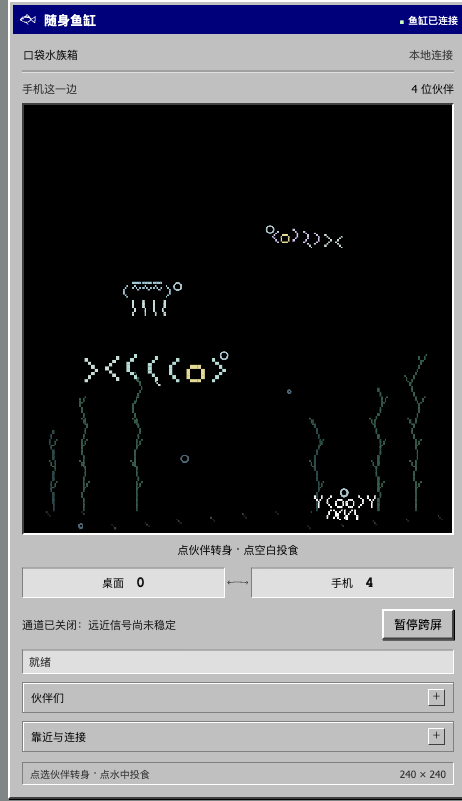

# Pocket Reef · 口袋鱼缸

把一小缸字符生物放在桌面，也能让它们游进手机。ESP32-S3 + ST7789 彩屏，手机浏览器即可互动，不需要 App 或云服务。

**[打开浏览器烧录](https://gmchenn-sys.github.io/pocket-reef/) · [下载稳定固件](https://github.com/gmchenn-sys/pocket-reef/releases/latest) · [详细烧录说明](FLASHING.md)**

当前稳定版 **V30 / REEF_LINK_STABLE_V30**，已在 ESP32-S3 N16R8 + 1.54 英寸 ST7789 240×240 上实机验证，手机跨屏连接已确认可持续打开。



*上图是本项目网页实际运行的截图，使用本地演示数据，非硬件实拍。字符造型与实体屏幕使用同样的像素字形和几何尺寸。*

## 可以做什么

两条一大一小的鱼、简笔小乌贼和白色小螃蟹各自随机游动、避让、吐泡泡，鱼缸底部有摆动的水草。手机端与实体屏幕使用同一套造型。

手机放在实体屏幕**右侧**，连接热点并保持网页前台；靠近时打开左右相接的通道。谁自然游到接缝，谁就跨过去，头部在另一边逐渐出现，尾部通过后才确认归属。手机里的生物游到左侧可以回家。拿开后已完成跨屏的生物留在各自鱼缸，不会被一键拉回。

点击手机上的生物可以让它转身；点击空白处会撒下鱼食，所有手机端生物都能追逐、逐颗吃掉，包括会上来吃食的螃蟹。手机页面采用 Windows 98 风格，全部资源嵌在固件里。

> **靠近判断使用 Wi-Fi RSSI，只是信号强弱估计，不是厘米级触碰传感器。** 满格信号不保证精准测距。手、手机方向、外壳和遮挡都会影响触发；页面里可以记录一个常用摆放位置。

## 硬件与接线

预编译固件仅针对 **ESP32-S3 N16R8（16MB Flash / 8MB OPI PSRAM）** 和 **ST7789 SPI 240×240**。不是通用 ESP32 固件，也不适用于 SSD1306 OLED。屏幕不需要触摸功能，互动发生在手机上。

| 屏幕标识 | ESP32-S3 引脚 |
| --- | --- |
| GND | GND |
| VCC | 3V3 |
| BL | 3V3 |
| SCL / SCK | GPIO12 |
| SDA / MOSI | GPIO11 |
| RST | GPIO8 |
| DC | GPIO9 |
| CS | GPIO10 |

断电后接线。BL 与 VCC 可以共用 3V3，GND 必须接 GND；这里的 SDA/SCL 是 **SPI 数据/时钟**，不是 I²C。供电和信号以模块的实际标识为准。

## 直接烧录

1. 按表接好屏幕，用能传数据的 USB 线连接开发板 **UART** 接口与电脑。
2. 电脑 Chrome / Edge 打开 **[烧录页面](https://gmchenn-sys.github.io/pocket-reef/)**，选择串口并安装。首次使用新板可擦除数据；更新现有鱼缸时不要勾选清空数据，以保留生物归属。
3. 烧录后等待启动，手机连接热点 **PocketReef**，密码 **Reef-258614**。
4. 手机 Safari 或其他浏览器打开 **http://192.168.4.1/**，手机放在实体屏幕右侧，网页保持前台。

浏览器烧录需要电脑的 Web Serial 支持；iPhone Safari 用于鱼缸互动，不用于 USB 烧录。不想使用网页烧录，可下载 Release 中的固件包并按 [FLASHING.md](FLASHING.md) 操作。

## 从源码编译

安装 Arduino CLI，使用下列已验证版本：

```sh
arduino-cli core update-index --additional-urls https://espressif.github.io/arduino-esp32/package_esp32_index.json
arduino-cli core install esp32:esp32@3.3.10 --additional-urls https://espressif.github.io/arduino-esp32/package_esp32_index.json
arduino-cli lib install "Adafruit ST7735 and ST7789 Library@1.11.0"
arduino-cli lib install "Adafruit GFX Library@1.12.6" "Adafruit BusIO@1.17.4"
python3 scripts/build.py
```

构建使用 `esp32:esp32:esp32s3:FlashSize=16M,PSRAM=opi,CDCOnBoot=default`。也可在 Arduino IDE 中打开 `AquariumHome/AquariumHome.ino`，选择 ESP32S3 Dev Module、16MB Flash、OPI PSRAM、USB CDC On Boot Disabled，然后编译上传。发布固件的 SPI / Flash 配置见 `docs/firmware/build-info.json`。

修改网页后先运行 `python3 AquariumHome/bundle_page.py`，再编译。手机端必须刷新页面才能加载新固件中的网页。更换 GPIO、屏幕驱动或尺寸时应自行适配并重新编译。

## 测试与预览

需要 Python 3、Node.js 和 C++17 编译器：

```sh
python3 scripts/test.py
python3 AquariumHome/preview_server.py
```

预览在 `http://127.0.0.1:8765`，十分钟后自动停止。预览服务器有专用模拟端点，**没有编进固件**。测试覆盖像素造型一致、随机游动/避让、逐颗喂食、跨屏拼接、重试幂等、归属保存、信号抖动与连接恢复。

## 常见问题

- **满格但通道关闭：**先区分“鱼缸已连接”和“通道已打开”。V30 会容忍短暂请求丢失；连续约 6 秒没有确认才因失联关闭。确认拿远、切后台或主动暂停另有关闭逻辑。
- **屏幕黑或静止：**先核对供电、GPIO、面包板接触和屏幕型号。无法烧录时按住 BOOT、短按 RST 后松开 BOOT；完成后只按 RST 或断电重插。UART 调试连接可能触发复位。
- **有画面但没有热点：**启动保护可能回退到纯鱼缸。程序运行时按住 BOOT 约 2 秒可以重试 Wi-Fi；不要关闭欠压保护来掩盖供电问题。
- **手机里少了某个生物：**归属保存在开发板 NVS 与浏览器身份中。不要随意清除 Safari 网站数据；清除后不会自动认回旧身份。当前没有云账号找回功能，需要重新初始化时可选择完整擦除安装。
- **能否自动知道手机在哪一侧：**不能。当前固定约定实体屏幕在左、手机在右，RSSI 无法判断方向，也无法保证贴合时的物理像素完全对齐。

更多实现细节见 [技术说明](AquariumHome/README.md)。现有固件不实现 OTA、账号系统、云同步或精确距离传感。

## 开源许可

本项目原创部分采用 [MIT](LICENSE)。Adafruit 字体、Arduino-ESP32、ESP-IDF 等依赖保留各自许可证，见 [第三方说明](THIRD_PARTY_NOTICES.md)。这是独立实现，不是其他创作者的原版源码。
